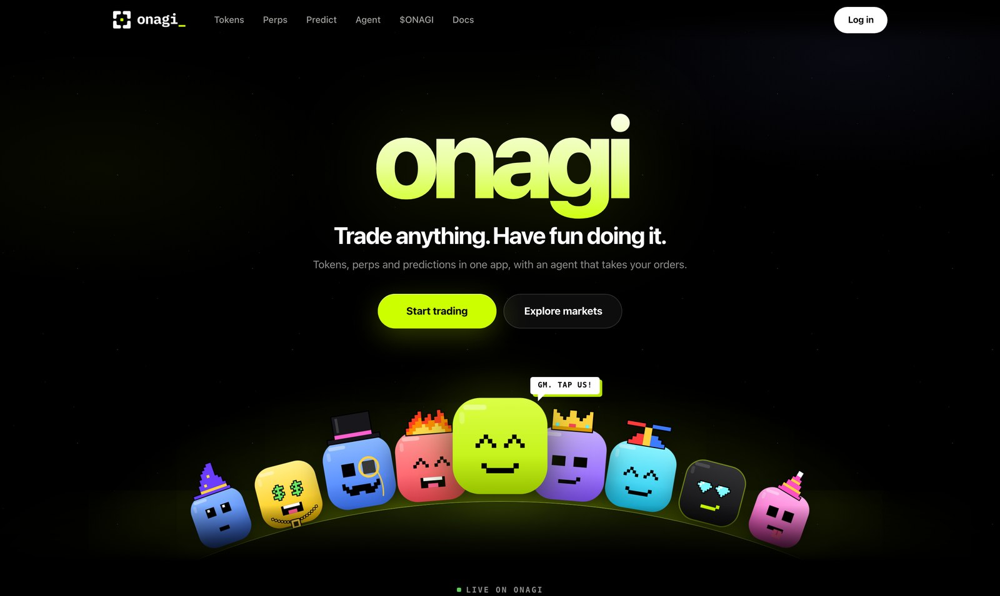
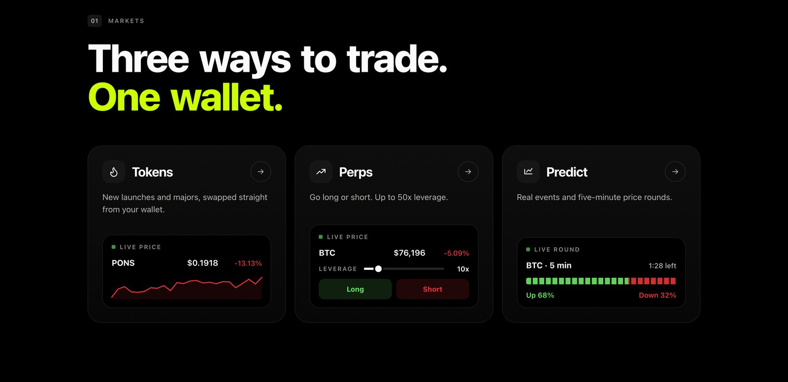
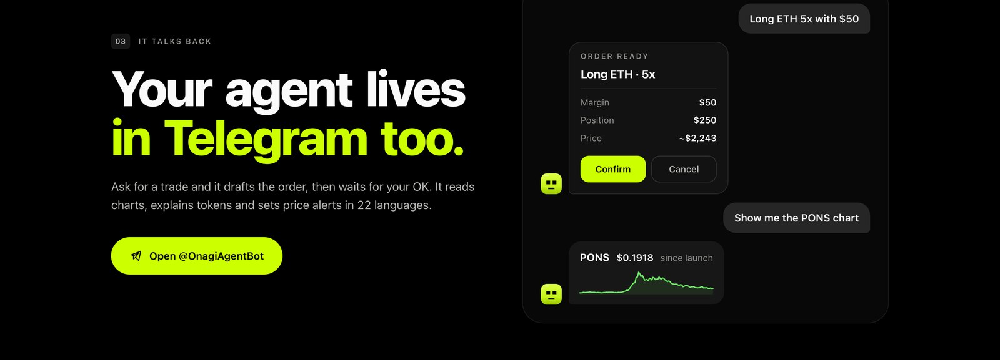
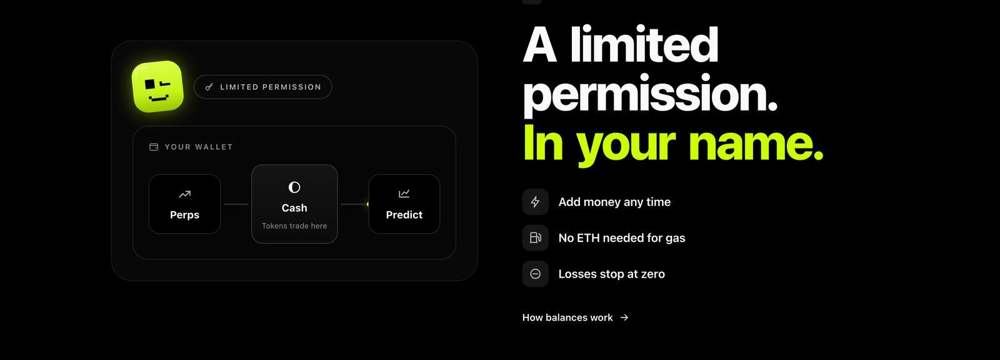
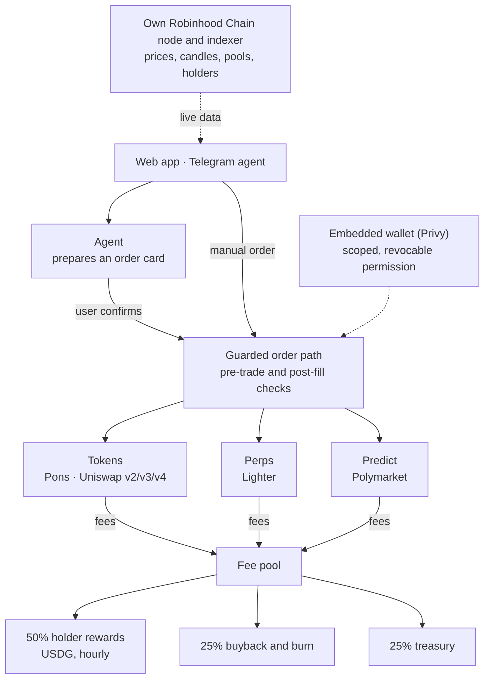
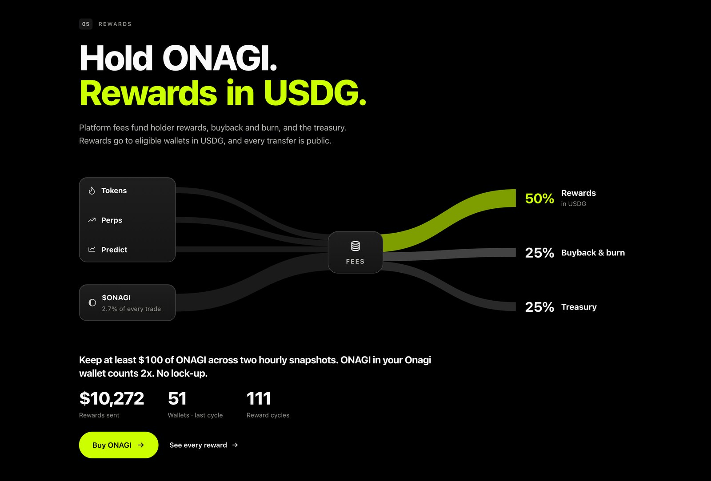

  <picture>
    <source media="(prefers-color-scheme: dark)" srcset="brand/onagi-lockup-on-black.svg">
    
  </picture>

<h3 align="center">The social trading app with an AI agent, on Robinhood Chain.</h3>

  Tokens, perps and predictions from one wallet. Trade yourself, follow other traders, 
  or tell your agent what you want and confirm the order it prepares.

  
  
  
  
  
  
  

  

---

## Contents

- [Onagi at a glance](#onagi-at-a-glance)
- [Products](#products)
- [Social trading](#social-trading)
- [The AI agent](#the-ai-agent)
- [Your money stays yours](#your-money-stays-yours)
- [Architecture](#architecture)
- [Fees](#fees)
- [Fee pool and holder rewards](#fee-pool-and-holder-rewards)
- [ONAGI token](#onagi-token)
- [Verification and public data](#verification-and-public-data)
- [Integrations](#integrations)
- [Documentation](#documentation)
- [Source code](#source-code)
- [Contact](#contact)

---

## Onagi at a glance

| | |
|---|---|
| **What** | Social trading app with an AI agent: tokens, perpetuals and prediction markets in one account |
| **Where** | Web ([app.onagi.si](https://app.onagi.si)) and Telegram ([@OnagiAgentBot](https://t.me/OnagiAgentBot)) |
| **Chain** | Robinhood Chain (EVM, chain id 4663). Solana tokens are tradable from the same account |
| **Custody** | Self-custodial. Embedded wallet per user; Onagi holds a limited, revocable trading permission |
| **Venues** | Pons and Uniswap v2 / v3 / v4 (tokens), Lighter (perps), Polymarket (predictions) |
| **Languages** | The agent speaks 22 languages |

**Traction** (as of November 6, 2026)

| Users | Have traded | Came back to trade again | Total trading volume | Active, last 7 days |
|:---:|:---:|:---:|:---:|:---:|
| **297** | **134** | **101** | **$657K+** | **193** |

Live figures: [DefiLlama](https://defillama.com/protocol/onagi) · [Dune](https://dune.com/onagi/onagi) · [Rewards record](https://onagi.si/payouts)

---

## Products

  

| Product | What you can do | Venue |
|---|---|---|
| **Tokens** | Swap new launches and majors straight from your wallet. Live boards for trending tokens, new launches and bonding curves, with warnings for copycats and low liquidity | Pons, Uniswap v2 / v3 / v4 on Robinhood Chain |
| **Perps** | Go long or short with up to 50x leverage on crypto, stocks and commodities. Isolated margin per position, with stops and targets placed on the exchange itself | Lighter, in an account opened in your wallet's name |
| **Predict** | Real event markets and five-minute price rounds on BTC, ETH, SOL and XRP | Polymarket, in a wallet opened in your name |

Money can also be brought in from other networks in one step, converted to USDG on Robinhood Chain.

---

## Social trading

Onagi is built around people, not just order books.

- **Live feed.** Every trade on the platform shows up in a public feed, next to posts from traders. Switch between Global and the people you follow.
- **Profiles.** Every trader has a profile with open and closed positions, results, stats and a result calendar.
- **Posts.** Write up to 3,000 characters straight from a position card. Every post shows the writer's position and result, and can be liked, replied to and shared as a card.
- **Token pages.** Holders, Trades and About tabs with a live feed. Only holders can post on a token's page.
- **Leaderboard.** Ranked on net results after fees.
- **Trade alerts.** Turn on alerts on a leaderboard trader's profile and get a message in Telegram or in the app every time they trade, with quick buy buttons.
- **Echo.** When a follower trades from a trader's alert buttons, the trader earns 20% of Onagi's fee on that trade. The follower pays nothing extra.
- **Referrals.** Every account has an invite link. Invited friends get 10% of their fees back; the inviter earns 25% of the rest, hourly, in USDG.

---

## The AI agent

  

Tell the agent what you want, in chat on the web or in Telegram.

1. **You ask.** "Long ETH 5x with $50", "buy $20 of ONAGI", "move $20 to Predict".
2. **It prepares a card.** The card shows the order exactly as the agent understood it.
3. **You confirm.** Only then is the order sent, through the same guard as an order placed by hand. Cancel the card and nothing is sent.

What else it does:

- Reads charts, explains tokens and prediction market rules, and summarises news with its source and age.
- Stop losses and take profits in dollars ("get me out if I'm down $5"), take profit in up to three steps.
- Orders that wait for a price: limit entries, token buys, stops, targets and price alerts.
- Live token lists (top gainers, most traded, new launches, close to graduating), with one confirmation to buy several tokens from a list.
- "Close everything" in one card.
- An on/off switch that only the user's wallet can change. Off, the agent only reads and explains.

---

## Your money stays yours

  

Onagi does not hold user funds. Sign-in (email, Google or X) creates an embedded wallet whose key is secured by Privy, not by Onagi. Each user has three pockets, all in their own name:

| Pocket | Where it lives |
|---|---|
| **Cash** | USDG in the user's embedded wallet on Robinhood Chain. Token swaps spend from here and rewards arrive here |
| **Perps** | The user's own Lighter account |
| **Predict** | The user's own Polymarket wallet |

The limited permission lets Onagi open and close positions in the user's name, move money between the user's own pockets and pay gas. It **cannot** send funds to any other address. It can be revoked at any time. No ETH is needed for gas: Onagi supplies it and collects it back in USDG as a network fee.

More: [docs/SECURITY-MODEL.md](docs/SECURITY-MODEL.md)

---

## Architecture

| Layer | Component | Role |
|---|---|---|
| Settlement | Robinhood Chain | Chain of record for wallets, rewards, the token and the fee wallet. Dollar asset: USDG |
| Identity | Embedded wallet | Created at sign-in. The key belongs to the user; the address is the account |
| Execution | Onagi keeper | Guarded order path, order queue, venue adapters, reconciliation, hourly rewards cycle |
| Data | Own chain node and indexer | Prices, candles, pools, holder sets and token metadata, streamed live to the app |
| Interfaces | Web app, Telegram agent | Same fees and the same checks, whether a person or the agent places the order |

**Engineering highlights**

- Every perps and token order passes the same guard before it reaches a venue (market list, price freshness, slippage, size) and is checked again after it fills.
- Ambiguous venue answers are treated as unknown, never as rejected: the venue is queried before anything is written, so no order is ever sent twice.
- Perps results and fees are reconciled against the exchange's own record, trade by trade.
- Load-tested with 20,000 traders at once; 10,000 stops closed in 84 seconds.

More: [docs/ARCHITECTURE.md](docs/ARCHITECTURE.md)

---

## Fees

Manual and agent orders pay the same rates, with no exemptions.

| Product | Onagi fee |
|---|---|
| Tokens | 1% per swap, in USDG |
| Perps | 0.10% per order, on top of the venue's own fee |
| Predict | 1% to buy a ticket, 1% to sell before resolution, no fee on the payout |
| Bringing money from another network | 0.5%, plus the bridge's own fee |
| ONAGI token | 3% total inside the swap (no extra 1%) |

More: [docs/FEES-AND-REWARDS.md](docs/FEES-AND-REWARDS.md)

---

## Fee pool and holder rewards

  

Platform fees and ONAGI creator fees fund one fee pool, split by a published allocation:

| Share | Goes to |
|---|---|
| **50%** | Holder rewards, sent hourly in USDG to every wallet holding at least $100 of ONAGI |
| **25%** | Buyback and burn |
| **25%** | Treasury |

No staking, no lock and nothing to claim. ONAGI held in an Onagi wallet counts 2x. Every reward transfer is public at [onagi.si/payouts](https://onagi.si/payouts).

---

## ONAGI token

| | |
|---|---|
| Contract (Robinhood Chain) | `0xbf2f5b48428fc7c6fb13bd7a4848f209f482b9df` |
| Supply | 1,000,000,000, fixed. No owner, no mint function |
| Launch | Pons, on Robinhood Chain. 92% open market from the first second |
| Treasury | 8%, bought at launch with our own ETH. 7.4% vests over 12 months in a public contract, 0.6% unlocked |
| Private sale | None. No advisor tranche |

The official address is announced only by [@tryonagi](https://x.com/tryonagi) and shown on [onagi.si/onagi](https://onagi.si/onagi). Any other address is fake.

More: [docs/TOKEN.md](docs/TOKEN.md)

---

## Verification and public data

| Source | Link |
|---|---|
| DefiLlama | https://defillama.com/protocol/onagi |
| Dune | https://dune.com/onagi/onagi |
| Rewards record | https://onagi.si/payouts |
| Cycle ledger (JSON) | https://onagi.si/data/cycles.json |
| Public wallets | [docs/VERIFICATION.md](docs/VERIFICATION.md) |

---

## Integrations

| Partner | How Onagi uses it |
|---|---|
| **Robinhood Chain** | Settlement chain for wallets, swaps, rewards and the ONAGI token |
| **Lighter** | Perpetual futures, in an account opened in each user's name |
| **Polymarket** | Event markets and five-minute price rounds |
| **Privy** | Sign-in and embedded wallets |
| **Pons** | Token launchpad and bonding curves; ONAGI launched here |
| **Uniswap** | v2, v3 and v4 pools for token swaps |
| **Relay** | Bringing money in from other networks |
| **Chainlink** | Price data shown and used for five-minute prediction rounds |

---

## Documentation

| Document | |
|---|---|
| [Architecture](docs/ARCHITECTURE.md) | Layers, order lifecycle, guards and failure handling |
| [Security model](docs/SECURITY-MODEL.md) | Custody, the trading permission, revocation |
| [Agent](docs/AGENT.md) | How the agent prepares, confirms and runs orders |
| [Fees and rewards](docs/FEES-AND-REWARDS.md) | Fee schedule, fee pool, holder rewards, referrals, Echo |
| [Token](docs/TOKEN.md) | Supply, treasury vesting, buyback and burn |
| [Verification](docs/VERIFICATION.md) | Public wallets and how to check every claim on-chain |
| [Brand assets](brand/) | Logos and colours |
| [Full docs](https://onagi.si/docs) | The complete, always-current reference on onagi.si |

---

## Source code

Onagi is a live trading platform, and its core code is closed source for security reasons. This repository holds public documentation and brand assets only.

Reviewers, partners and grant programs can request private repository access at **info@onagi.si**.

Security reports: see [SECURITY.md](SECURITY.md).

---

## Contact

| | |
|---|---|
| Email | info@onagi.si |
| X | [@tryonagi](https://x.com/tryonagi) |
| Telegram agent | [@OnagiAgentBot](https://t.me/OnagiAgentBot) |
| Support | [onagi.si/support](https://onagi.si/support) |

---

Onagi is an experimental crypto project, not a broker, bank or investment adviser. Funds stay in your own wallet and venue accounts. Rewards depend on platform fees and can change, and any money in a trade can be lost. Leveraged trading carries a high risk of loss. Nothing here is investment advice. ONAGI is not a share and grants no right to revenue or control over the platform. Not available to persons in restricted jurisdictions.

© 2026 Onagi. All rights reserved.
