# Onagi brand assets

Official Onagi logos and characters for partners, listings and press.

## Colours

| Name | Hex |
|---|---|
| Onagi lime | `#CCFF00` |
| White | `#FAFAFA` |
| Black | `#000000` |

Typeface: [Inter](https://fonts.google.com/specimen/Inter).

## Files

| File | Use |
|---|---|
| `onagi-lockup-on-black.svg` / `.png` | Full logo (mark + wordmark) on dark backgrounds |
| `onagi-lockup-on-white.svg` / `.png` | Full logo on light backgrounds |
| `onagi-lockup-lime.svg` / `.png` | Full logo with the lime accent, on dark backgrounds |
| `onagi-icon-on-black.svg` / `-512.png` | App icon on black |
| `onagi-icon-on-white.svg` / `-512.png` | App icon on white |
| `onagi-mark-lime.svg` | Mark in Onagi lime, for dark backgrounds |
| `onagi-wordmark-lime.png` | The "onagi" wordmark in lime, as used on the website |
| `onagi-agent.svg` / `-512.png` | The Onagi agent character |
| `crew/*.svg` | The Onagi crew: the characters users pick as their face |

## The crew

  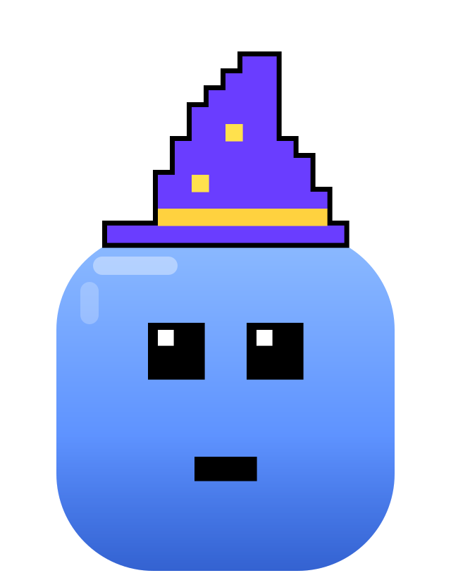
  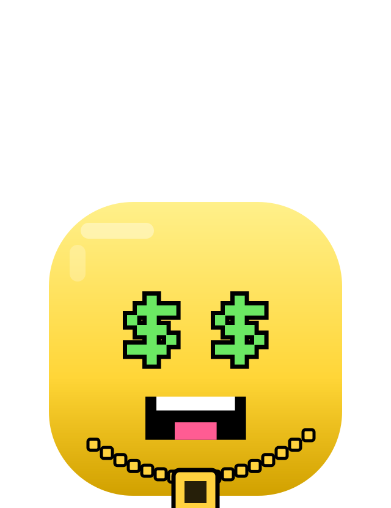
  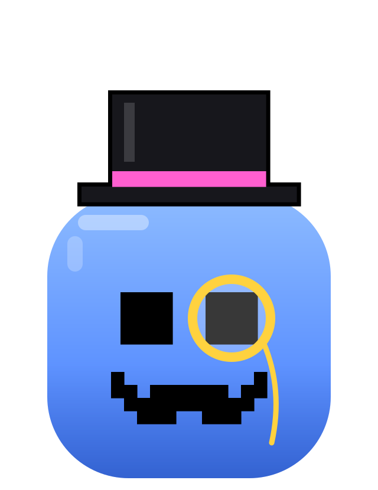
  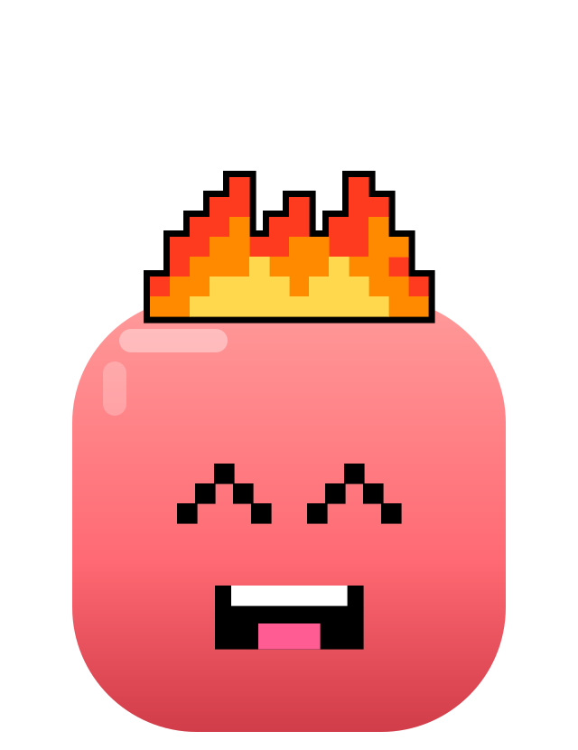
  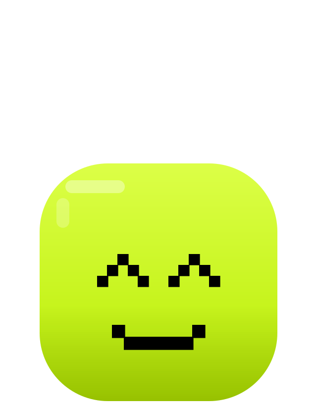
  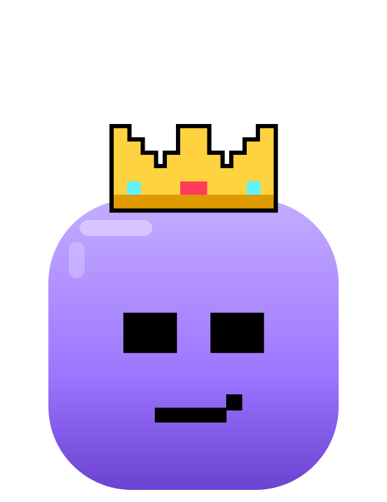
  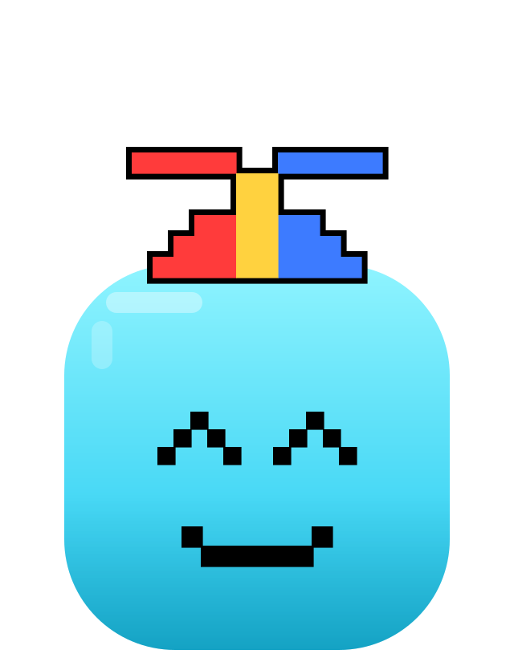
  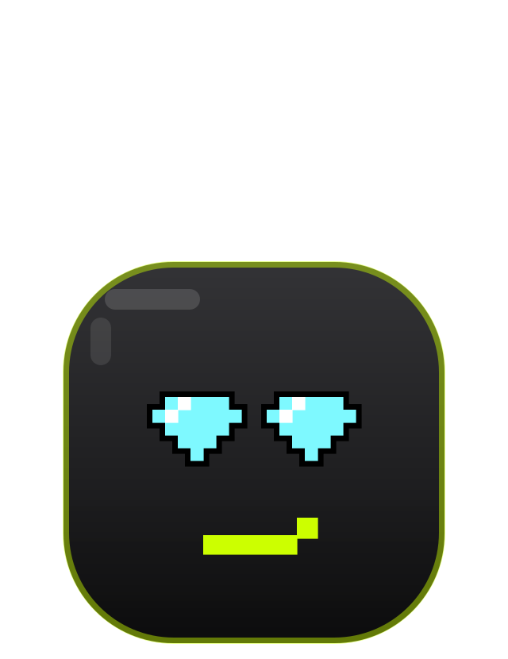
  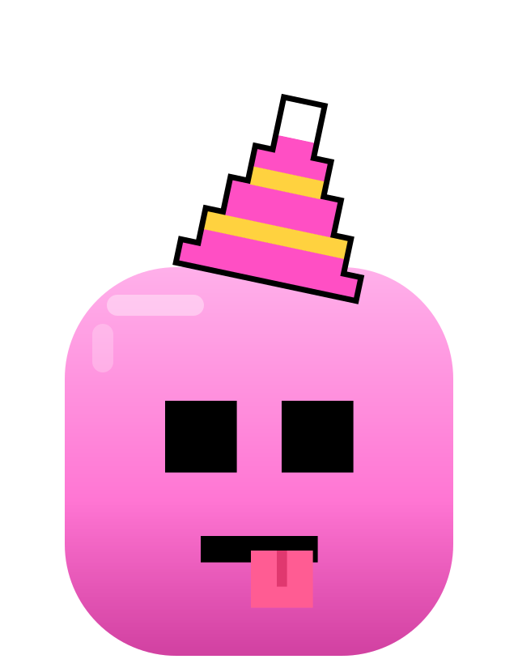
  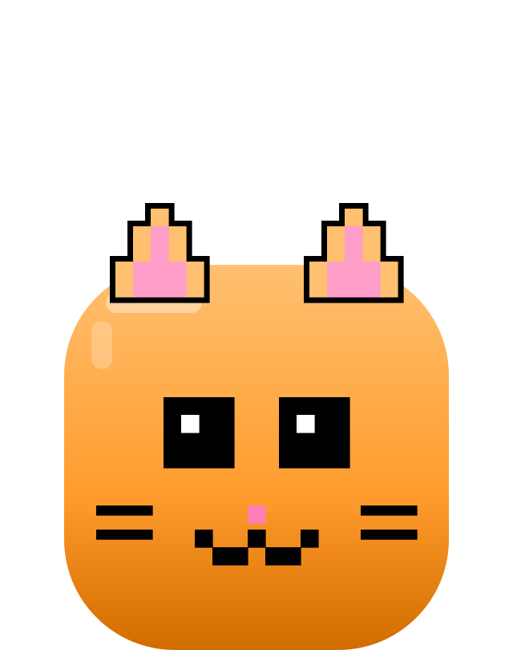
  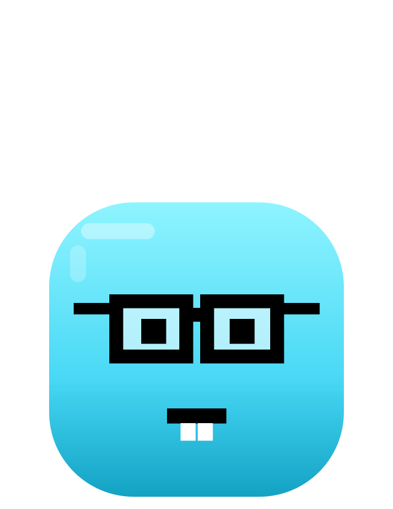

## Usage

- Keep clear space around the logo and do not stretch, recolour or add effects.
- Use the dark-background versions on dark surfaces and the light versions on light surfaces.
- The Onagi name and logos are trademarks of Onagi. Use them to refer to Onagi, not to suggest endorsement.

Questions: info@onagi.si
