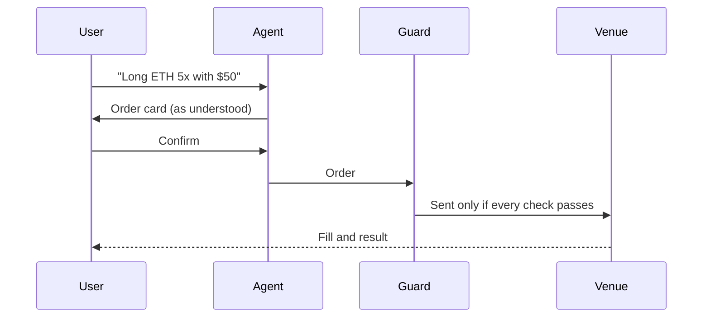

# The Onagi agent

The agent lives on the Agent page of the web app and in Telegram ([@OnagiAgentBot](https://t.me/OnagiAgentBot)). It speaks 22 languages.

## How an order happens

1. **You ask.** For example "long ETH 5x with $50", "buy $20 of ONAGI" or "move $20 to Predict".
2. **It prepares a card.** The card shows the order as the agent understood it.
3. **You confirm.** Only then is the order sent, through the same guard as an order placed by hand. Cancel the card and nothing is sent.

The one exception is the buttons under a Trade alert in Telegram: an amount button buys, and a sell button sells, in one tap, and only while the agent's switch is on.

## What it can do

| Capability | Examples |
|---|---|
| Trade | Tokens, perps and predictions, with the same fees and checks as manual orders |
| Risk in dollars | "Get me out if I'm down $5": the agent works out the price from the size and fees. "If it doubles" sets the take profit at twice the price |
| Orders that wait for a price | Limit entries, token buys, stop losses, take profits (up to three steps) and price alerts |
| Close everything | One card that closes all positions, cancels waiting entries and sells prediction tickets |
| Explain | Balances and positions, chart readings, a token's background, a market's resolution rules, news with its source and age |
| Token lists | Top gainers, most traded, new launches, close to graduating; buy up to 8 from a list with one confirmation |
| Trade alerts | Messages when a followed leaderboard trader trades, with quick buy amounts |
| Support | Feedback or /support goes to a person on the team, who replies in the same chat |

## Safety

- Just before a card with a stop or a target opens a position, both are checked again at the current price. If the price has already moved past either one, nothing opens.
- Orders that open a position or buy a token expire after 30 days if their price is not reached. Stops and take profits do not expire.
- The agent has an on/off switch that only the user's wallet can change. Off, it only reads and explains and prepares nothing new.
- A daily chat limit (30, 100 or 250 messages, depending on trading activity) protects the service; waiting orders keep working when it is reached.

---

[Back to README](../README.md) · Full reference: [onagi.si/docs](https://onagi.si/docs)
