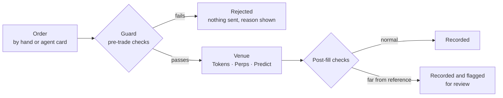

# Architecture

Four layers connect a user's wallet to the markets and to the fee pipeline. The execution layer acts on venues with the user's permission, in the user's name. Onagi is never the counterparty to a trade and never holds a user's margin.

## Layers

| Layer | Component | Role |
|---|---|---|
| Settlement | Robinhood Chain (EVM, chain id 4663) | Chain of record for wallets, rewards, the ONAGI token and the fee wallet. Dollar asset: USDG |
| Identity | Embedded wallet | Created at sign-in (email, Google or X). The key belongs to the user and is secured by Privy; the address is the account |
| Execution | Onagi keeper | Guarded order path, order queue, venue adapters, reconciliation, hourly rewards cycle |
| Data | Own chain node and indexer | Prices, candles, pools, holder sets and token metadata read from Onagi's own Robinhood Chain node and streamed to the app |
| Venue: Tokens | Uniswap (v2, v3, v4) and Pons | Token swaps from the wallet, launchpad discovery and bonding curves |
| Venue: Perps | Lighter | Perpetual futures. Account opened in the user's wallet's name; margin lives there |
| Venue: Predict | Polymarket | Event markets and five-minute price rounds. Wallet opened in the user's name |
| Interfaces | Web app, Telegram agent | Same fees and the same checks, whether a person or the agent places the order |

## Order lifecycle

A rejection at the guard sends nothing to the venue. A completed venue trade cannot be undone, so the post-fill checks record and flag rather than reverse.

## Guard checks

Every perps and token order is checked by the same guard, whether it is placed on the site or through the agent. Prediction tickets pass their own checks before they are sent.

| Check | Rule |
|---|---|
| Market list | Every leveraged market the venue lists can be traded. The leverage cap depends on the market and is shown on the card |
| Price freshness | A new perps position is refused when the latest venue price is more than 120 seconds old |
| Slippage | Expected slippage is estimated from the order book (perps) or pool depth (tokens) and must stay under the cap. For tokens the cap is the user's max slippage: 5% by default, adjustable from 0.1% to 50% |
| Size | An order must meet the venue's minimum size for that market |
| After the fill | A fill far from the reference price is recorded and flagged for review |

## Failure handling

| Condition | Behaviour |
|---|---|
| Venue does not answer, or answers ambiguously | The order is treated as unknown, not as rejected. The venue is queried before anything is written; the user is told only what is certain |
| Fill differs from the ledger | The ledger is checked against the venue's own record, which is the reference. A difference is flagged and corrected to match the venue |
| Price feed stale | No new perps positions open until a fresh price arrives. Open positions continue to be managed |
| Component down | A watchdog restarts services and alerts the operators. Unavailable components on the order path block new orders until service recovers |

## Stops and targets

Stops and full take profits on a perps position are placed on Lighter as orders tied to that position and are triggered by the exchange on the mark price. Onagi also watches each one as a backup and closes the position itself if the exchange order is missing or has not filled. Take-profit steps, and stops on tokens, are run by Onagi and checked every few seconds.

## Scale

Onagi rehearses load before it is needed. In a rehearsal with extra capacity turned on, 20,000 traders traded at the same time and 10,000 stops closed in 84 seconds. In an earlier rehearsal with 2,000 simultaneous traders, no order was ever sent twice.

---

[Back to README](../README.md) · Full reference: [onagi.si/docs](https://onagi.si/docs)
