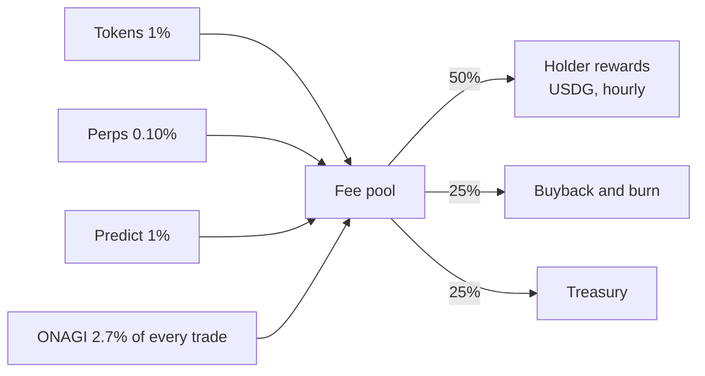

# Fees and rewards

## Fee schedule

Manual and agent orders pay the same rates, with no exemptions.

| Product | Onagi fee | Notes |
|---|---|---|
| Tokens | 1% per platform swap | Charged in USDG from Cash. No minimum size |
| Perps | 0.10% per order | On top of the venue's own fee. Order floor $11 or the market's higher minimum |
| Predict | 1% to buy, 1% to sell before resolution | No fee on the payout. Some markets also carry Polymarket's own fee |
| Bringing money from another network | 0.5% | Taken inside the bridge; the bridge (Relay) adds its own fee |
| ONAGI token on Pons | 3% in total | Pons' 1% base fee plus Onagi's 2% creator fee; no extra 1% on top |

## The fee pool

Platform trading fees and ONAGI creator fees fund one pool.

Referral and Echo rewards come off the fee before the split.

## Holder rewards

| Parameter | Value |
|---|---|
| Cadence | Checked every hour; a cycle opens once the pool reaches $100 |
| Eligibility | At least $100 of ONAGI. No sign-in, staking or lock |
| Multiplier | 1x in another wallet, 2x in an Onagi wallet |
| Holding time | The smaller of the balance now and one hour ago counts |
| Delivery | USDG straight to the wallet, in batched transfers. Nothing to claim |
| Reward floor | $0.50 net per transfer; smaller shares accrue in the wallet's name |
| No eligible wallet | Half of that cycle's pool to the treasury, half to buyback and burn |

There is no reward cap and no discretionary extra share. Platform wallets never count as holders.

## Referrals

| Parameter | Value |
|---|---|
| Link | onagi.si/r/yourname |
| Friend's rebate | 10% of the friend's Onagi fees |
| Inviter's reward | 25% of the rest |
| Duration | As long as the friend trades, no cap |
| Delivery | Hourly, in USDG |

On every $1.00 of fees a friend pays: $0.10 goes back to the friend, $0.225 to the inviter and $0.675 joins the fee pool.

## Echo

When a follower trades from the buttons of a trader's Trade alert, the trader earns **20% of Onagi's fee** on that trade (and on its close), hourly, in USDG. The follower pays nothing extra. Echo follows trades, not results, and is not payment for advice.

---

[Back to README](../README.md) · Full reference: [onagi.si/docs](https://onagi.si/docs)
